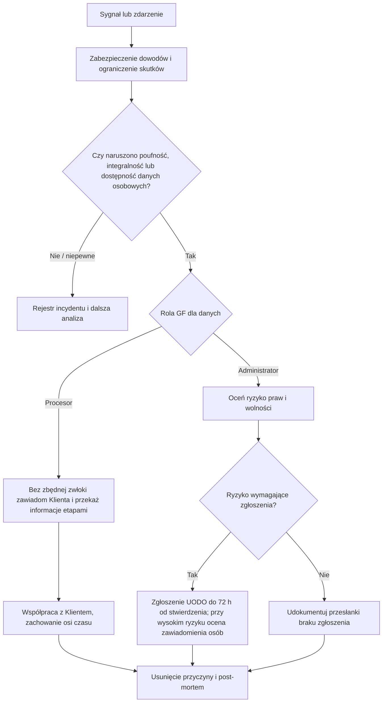

# Procedura naruszenia ochrony danych osobowych

| Metadane | Wartość |
| --- | --- |
| Produkt | GF |
| Wersja | 0.2.0-draft |
| Status | DRAFT – WYMAGA WERYFIKACJI |
| Właściciel | [DO WYPEŁNIENIA: WŁAŚCICIEL DOKUMENTU] |
| Recenzent | [DO WYPEŁNIENIA: RECENZENT] |
| Data obowiązywania | [DO WYPEŁNIENIA: DATA OBOWIĄZYWANIA] |
| Data przeglądu | 2026-10-19 — przegląd redakcyjny i kodu; bez zatwierdzenia prawnego |
| Dokumenty powiązane | DPA; checklista 72h; rejestr |
| Klasyfikacja | POUFNY / DANE O INCYDENCIE |

> Projekt do weryfikacji prawnej, RODO, księgowej, podatkowej, biznesowej i technicznej w odpowiednim zakresie. Nie stanowi finalnej porady ani gwarancji zgodności lub bezpieczeństwa.

## 1. Rozróżnienie ról

Jako procesor GF zawiadamia administratora (Klienta) bez zbędnej zwłoki po stwierdzeniu naruszenia i współpracuje. To administrator co do zasady ocenia ryzyko oraz obowiązek zgłoszenia organowi w 72 godziny i zawiadomienia osób. Dla danych własnych GF działa jako administrator. Terminu 72 godzin nie należy przedstawiać jako terminu procesora do UODO bez analizy roli.

## 2. Przepływ

## 3. Minimalny materiał

Charakter naruszenia, kategorie i przybliżona liczba osób/rekordów, czas wykrycia i stwierdzenia, systemy, prawdopodobne konsekwencje, podjęte/planowane środki, punkt kontaktowy oraz braki uzupełniane etapami. Nie opóźniać pierwszego zawiadomienia Klienta z powodu niepełnych danych.

## 4. Szablon zawiadomienia Klienta

**Temat:** PILNE — możliwe naruszenie danych / **[DO WYPEŁNIENIA: ID]**. Stwierdzono: **[DO WYPEŁNIENIA]**. Zakres: **[DO WYPEŁNIENIA]**. Skutki: **[DO WYPEŁNIENIA]**. Środki: **[DO WYPEŁNIENIA]**. Następna aktualizacja: **[DO WYPEŁNIENIA]**. Kontakt: **[DO WYPEŁNIENIA]**.

## 5. Dokumentacja i zamknięcie

Odnotować moment „stwierdzenia”, decyzje, podstawę oceny ryzyka, powiadomienia i uzasadnienie. Zamknięcie wymaga właściciela, działań korygujących i daty weryfikacji skuteczności.

## Podstawy i materiały do weryfikacji

- [RODO – art. 5, 24–36](https://eur-lex.europa.eu/legal-content/PL/TXT/?uri=CELEX:32016R0679)
- [UODO – materiały o naruszeniach](https://uodo.gov.pl/pl/598/3563)
- [Wytyczne EROD 07/2020](https://www.edpb.europa.eu/documents/guideline/guidelines-072020-on-the-concepts-of-controller-and-processor-in-the-gdpr_en)

## Decyzja o naruszeniu i terminy ustawowe

Naruszenie danych obejmuje przypadkowe lub niezgodne z prawem zniszczenie, utratę, zmianę, ujawnienie albo dostęp; może dotyczyć także dostępności bez wycieku. Rejestruje się moment wykrycia oraz moment uzyskania wystarczającej pewności naruszenia. Nie każdy błąd techniczny jest naruszeniem danych.

Procesor informuje Administratora bez zbędnej zwłoki po stwierdzeniu, nie czeka 72 godzin ani na pełny raport. Pierwsze informacje i kolejne uzupełnienia zawierają charakter, przybliżoną liczbę osób i rekordów, konsekwencje, kontakt i środki. Administrator zawiadamia właściwy organ bez zbędnej zwłoki, w miarę możliwości do 72 godzin od stwierdzenia, chyba że jest mało prawdopodobne ryzyko naruszenia praw lub wolności. Przy opóźnieniu wyjaśnia przyczyny; informacje może przekazywać etapami. Każde naruszenie dokumentuje zgodnie z art. 33 ust. 5, również niezgłoszone.

Przy wysokim ryzyku Administrator zawiadamia osoby bez zbędnej zwłoki jasnym językiem, z informacją o skutkach, kontakcie i środkach, chyba że zachodzi i została udokumentowana przesłanka art. 34 ust. 3. Szyfrowanie chroni tylko w swoim rzeczywistym zakresie; nie zwalnia automatycznie przy przejętym koncie, ekranie blokady lub ujawnionych kluczach.

Triage GF obejmuje ujawnienie JWT, zgadywanie krótkich haseł, błędne uprawnienia i izolację, eksporty, utratę SQLite/kopii oraz endpoint/klucze push i powiadomienia na wspólnym urządzeniu. Przy push zatrzymać wysyłkę i ocenić rzeczywistego odbiorcę, a nie tylko wynik „sent”. Zabezpieczyć minimalne dowody bez publikowania payloadów i endpointów. Kanały stron, zastępstwa i potwierdzenie ćwiczenia: [OWNER_REQUIRED: kontakty incydentowe; PRODUCTION_TEST_REQUIRED: test eskalacji]. Podstawy: RODO art. 4 pkt 12, 33–34; materiały UODO https://uodo.gov.pl/pl/525/2584.
